<a href="https://jorgecalleja.dev">
  <picture>
    <source media="(prefers-color-scheme: dark)" srcset="assets/header-dark.svg" />
    <source media="(prefers-color-scheme: light)" srcset="assets/header-light.svg" />
    
  </picture>
</a>

<p align="center">
  <a href="https://jorgecalleja.dev"></a>
  <a href="https://x.com/memento_academy"></a>
</p>

<p align="center">
  <sub>This profile is a tiny chain. Every section below is a block: scroll to sync. ⛓️</sub>
</p>

---

## `block #0` · Genesis

I build full-stack decentralized applications with **React**, **TypeScript** and **Solidity**, focused on **DeFi**, **asset tokenization** and **Account Abstraction**.

Instead of a JSON object, here is me as a contract (it compiles with `solc 0.8.24`, try it):

```solidity
// SPDX-License-Identifier: MIT
pragma solidity ^0.8.24;

/// @title  Jorge Calleja
/// @notice Web3 & Blockchain Developer based in Málaga, Spain
contract JorgeCalleja {
    string public constant location = unicode"Málaga, Spain 🇪🇸";

    string[3] public focus = ["DeFi Protocols", "Asset Tokenization", "Account Abstraction"];
    string[3] public currentlyLearning = ["ZK-Proofs", "Layer 2 Solutions", "Cross-chain Bridges"];
    string[2] public openTo = ["Startup Collaborations", "Open Source Projects"];

    event Collaboration(address indexed you, string idea);

    /// @notice Got an idea? Emit it and let's build together.
    function collaborate(string calldata idea) external {
        emit Collaboration(msg.sender, idea);
    }
}
```

---

## `block #1` · Toolchain

| Layer | Tools |
|---|---|
| **Blockchain** |      |
| **Frontend** |     |
| **Backend & Infra** |        |

---

## `block #2` · Deployments

<table>
  <tr>
    <td width="50%" valign="top">
      <h3>Banco del Tiempo</h3>
      <p><code>status: live</code> · <code>tx: full-stack</code></p>
      <p>Time banking platform where users exchange services using time as currency (<b>1h = 1 credit</b>). Server Actions and JWT auth; the full-stack evolution of a React/Vite + Express + MySQL project.</p>
      <p><sub>Next.js 16 · React 19 · Prisma 6 · PostgreSQL · Tailwind 4 · shadcn/ui · Zod · JWT</sub></p>
      <p>
        <a href="https://github.com/CallejaJ/timebankonchain"></a>
        <a href="https://www.bancodeltiempomalaga.com/"></a>
      </p>
    </td>
    <td width="50%" valign="top">
      <h3>Memento Academy</h3>
      <p><code>status: live</code> · <code>tx: web3 + IaC</code></p>
      <p>Free Web3 educational platform with a gamified crypto quiz (earn <b>MEMO</b> tokens), premium courses, and full AWS infrastructure as code.</p>
      <p><sub>Next.js 15 · TypeScript · AWS · Terraform · GitHub Actions · Prisma · Supabase</sub></p>
      <p>
        <a href="https://github.com/CallejaJ/memento-academy"></a>
        <a href="https://memento-academy.com/"></a>
      </p>
    </td>
  </tr>
  <tr>
    <td colspan="2" valign="top">
      <h3>jorgecalleja.dev</h3>
      <p><code>status: live</code> · <code>tx: performance + SEO</code></p>
      <p>My own site: a web studio for small businesses in Málaga, with a built-in <b>PageSpeed Insights</b> website analyzer and content structured for both search engines and AI assistants (<code>llms.txt</code>, structured data).</p>
      <p><sub>Next.js 15 · React 19 · TypeScript · Tailwind CSS · shadcn/ui · Framer Motion · Resend · Vercel</sub></p>
      <p>
        <a href="https://jorgecalleja.dev"></a>
      </p>
    </td>
  </tr>
</table>

<p align="center"><sub>More contracts deployed in my <a href="https://github.com/CallejaJ?tab=repositories">repositories</a>.</sub></p>

---

## `block #3` · On-chain activity

<p align="center">
  
</p>

---

## `block #4` · Call `collaborate()`

<p align="center">
  Building something in DeFi, tokenization or Account Abstraction? Let's talk.
</p>

<p align="center">
  <a href="https://x.com/memento_academy"></a>
  <a href="https://jorgecalleja.dev"></a>
</p>

<p align="center">
  <picture>
    <source media="(prefers-color-scheme: dark)" srcset="https://raw.githubusercontent.com/CallejaJ/CallejaJ/main/dist/github-contribution-grid-snake-dark.svg" />
    <source media="(prefers-color-scheme: light)" srcset="https://raw.githubusercontent.com/CallejaJ/CallejaJ/main/dist/github-contribution-grid-snake.svg" />
    
  </picture>
</p>

<p align="center"><sub><code>// a snake mining my contribution graph, re-generated every 12 hours</code></sub></p>
